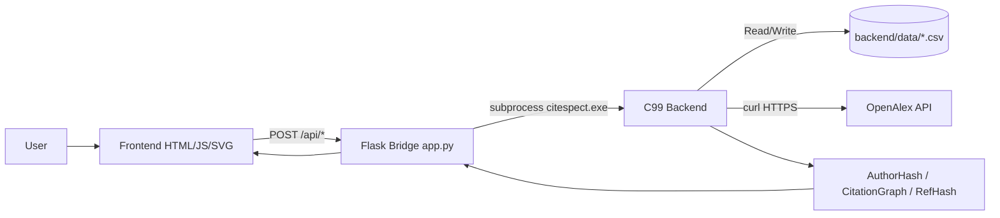
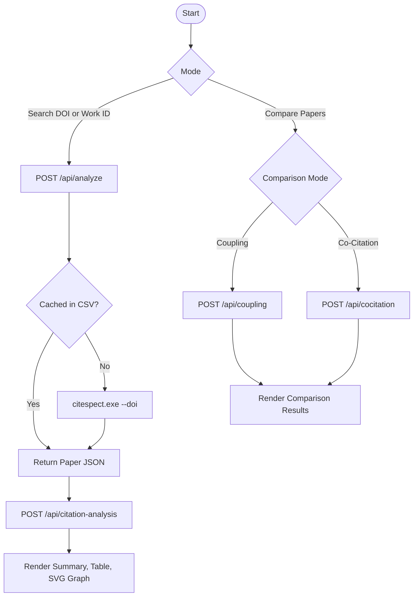
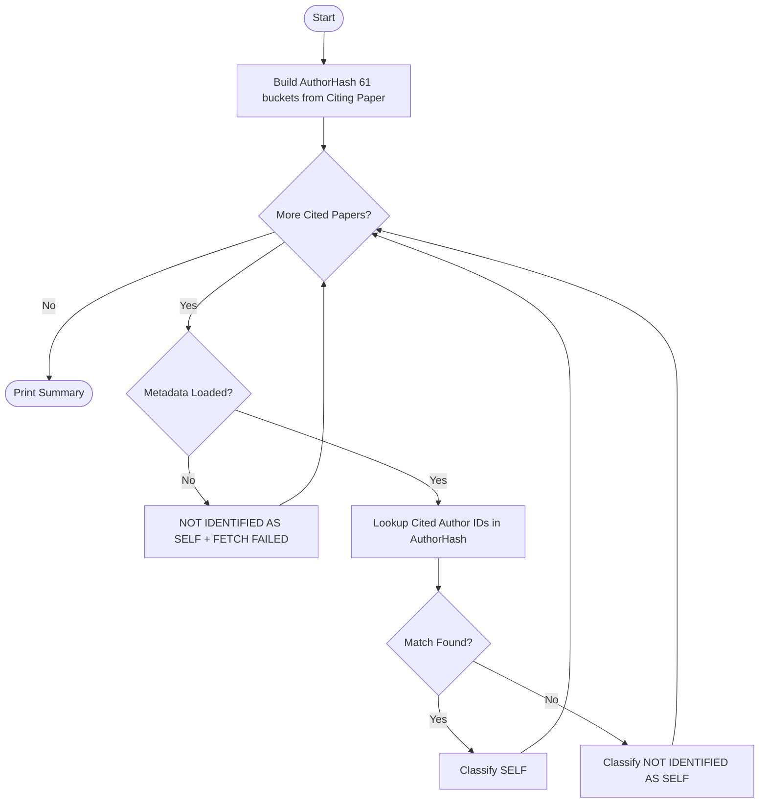
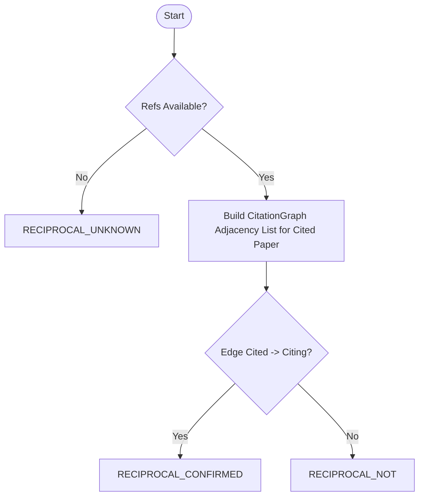
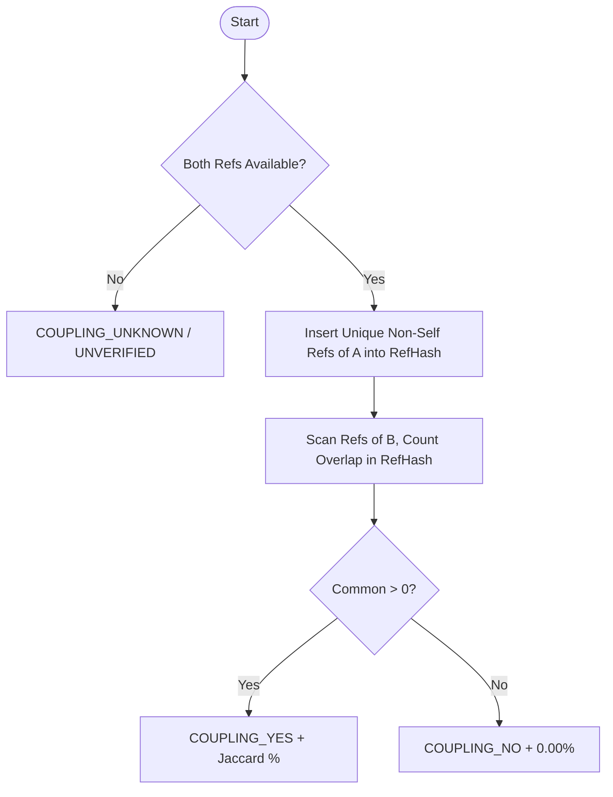
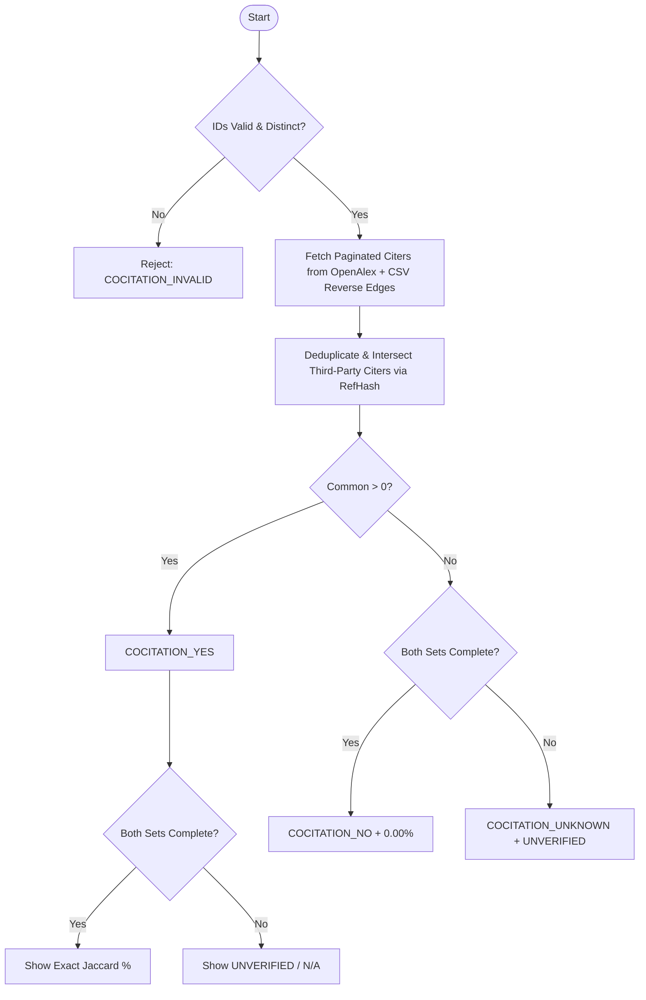

# System Architecture and Flowcharts

## End-to-End Data Flow (Verified Against Code)
`User (Browser/CLI)` -> `Frontend (index.html, script.js)` -> `Flask Bridge (bridge/app.py)` -> `C99 Backend (citespect.exe)` -> `OpenAlex API (curl) / Local CSVs (backend/data/*.csv)` -> `C99 Algorithms (AuthorHash, CitationGraph, RefHash)` -> `Stdout / JSON` -> `Frontend UI & SVG Graph`

---

## Overall System Workflow

---

## Self-Citation Detection Flowchart

---

## Reciprocal Citation Detection Flowchart

---

## Bibliographic Coupling Flowchart

---

## Co-Citation Detection Flowchart

